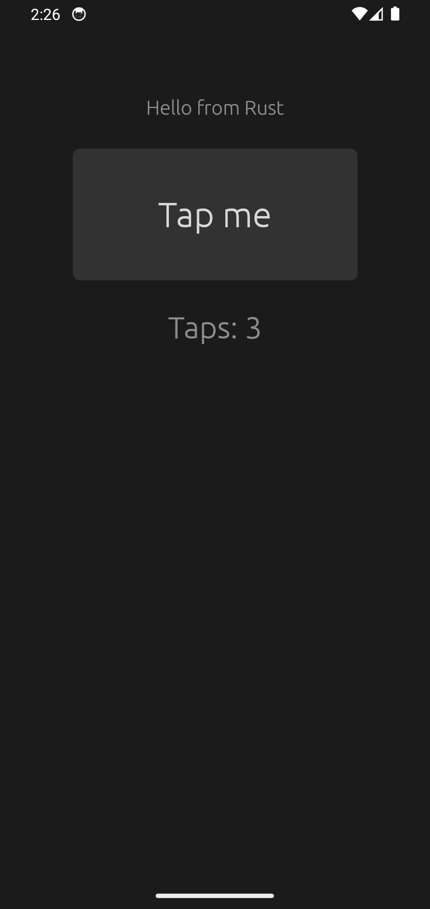
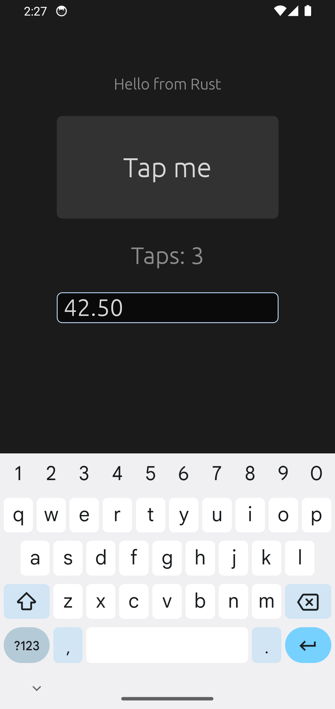
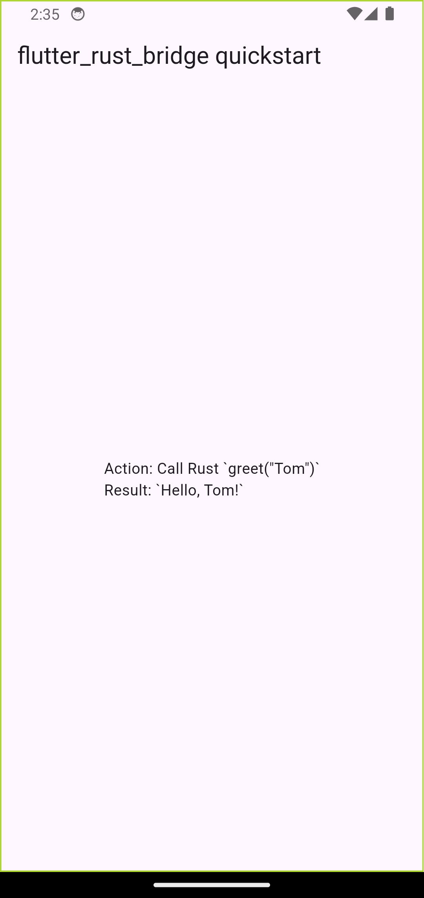

# Rust On Demand

An AI harness that turns a plain-language request into a working Rust app on a real Android phone. It's built for people who don't write code, and it targets old phones that would otherwise sit in a drawer as e-waste.

You describe what you want ("an app that splits a restaurant bill between friends, with tip"). The harness does the rest:

| Stage | What happens |
|---|---|
| 1. Intent | You describe the goal in plain language |
| 2. Spec | The harness writes a concrete spec with testable acceptance checks |
| 3. Code | It writes the Rust app |
| 4. Compile | It builds the app and fixes its own compiler errors |
| 5. Simulate | It runs the app in the Android emulator |
| 6. Flash | It installs the app on a physical phone over USB |
| 7. Observe | It checks logs and screens against the spec, and loops back to Code on failure |

A proof of concept by Ipser Labs.

## Status

| Phase | State |
|---|---|
| 0. Toolchain spike | **Done.** See [docs/phase0-findings.md](docs/phase0-findings.md) |
| 1. Loop skeleton (`harness run "<intent>"`) | Next |
| 2. AI in the loop | Planned |
| 3. Real device | Planned |
| 4. Demo runs | Planned |

### Phase 0 results

- A hand-written Rust app (egui UI) builds into one 5.3 MB APK for both 64-bit and 32-bit ARM phones, installs on the emulator, and responds to scripted taps and typing. Results are checked from logcat and screenshots.
- Supports **Android 5.0 (API 21) and newer**, the floor set by Android NDK r30.
- Two UI approaches were built and compared: pure Rust (egui) and Flutter + `flutter_rust_bridge`. **Recommendation: pure Rust.** One language and one build tool, a 5.3 MB APK against 28.3 MB, and it reaches older phones. Full comparison in the findings.

| Scripted taps | Typing via the soft keyboard | Flutter + Rust comparison |
|---|---|---|
|  |  |  |

## Repository layout

```
CLAUDE.md                 Project brief and working agreements
env.sh                    Sets up paths for every tool (source before working)
docs/
  phase0-findings.md      Toolchain spike report and UI recommendation
  decisions.md            Log of choices and why
  phase0-evidence/        Screenshots and logs from the emulator runs
spikes/
  hello-egui/             Pure-Rust Android app (egui + NativeActivity)
  hello_frb/              Flutter + flutter_rust_bridge comparison app
```

## Setup from a clean Mac

Tested on an Apple Silicon Mac. Everything installs into one APFS disk image, so it stays off a nearly full internal disk and works even when the project sits on an exFAT external drive. The image needs about 15 GB, or 25 GB with Flutter.

1. Clone the repo and enter it:
   ```bash
   git clone git@github.com:prunus77/Rust_On_Demand.git && cd Rust_On_Demand
   ```
2. Create the toolchain disk image (it grows as needed, up to 80 GB):
   ```bash
   hdiutil create -type SPARSEBUNDLE -fs APFS -size 80g -volname IpserToolchain toolchain.sparsebundle
   ```
3. Load the environment. This mounts the image and points every tool at it:
   ```bash
   source env.sh
   ```
4. Install Rust and the Android targets:
   ```bash
   curl -sSf https://sh.rustup.rs | sh -s -- -y --no-modify-path --profile minimal && rustup target add aarch64-linux-android armv7-linux-androideabi
   ```
5. Install JDK 17 (Temurin):
   ```bash
   curl -sSL "https://api.adoptium.net/v3/binary/latest/17/ga/mac/aarch64/jdk/hotspot/normal/eclipse" | tar -xz -C "$TMPDIR" && mv "$TMPDIR"/jdk-17* "$TC/jdk"
   ```
6. Install the Android command-line tools:
   ```bash
   curl -sSL -o "$TMPDIR/clt.zip" https://dl.google.com/android/repository/commandlinetools-mac-15641748_latest.zip && unzip -q "$TMPDIR/clt.zip" -d "$TMPDIR" && mkdir -p "$ANDROID_HOME/cmdline-tools" && mv "$TMPDIR/cmdline-tools" "$ANDROID_HOME/cmdline-tools/latest"
   ```
7. Accept the Android licenses and install the SDK, NDK and emulator image (several GB):
   ```bash
   yes | sdkmanager --licenses >/dev/null; sdkmanager "platform-tools" "emulator" "platforms;android-35" "build-tools;35.0.1" "ndk;30.0.16248370" "system-images;android-34;google_apis;arm64-v8a"
   ```
8. Install the Rust Android build helpers:
   ```bash
   cargo install cargo-ndk cargo-apk
   ```
9. Create a local signing key for test builds (stays on the image, never in git):
   ```bash
   mkdir -p "$TC/keys" && keytool -genkeypair -keystore "$TC/keys/ipser-dev.keystore" -alias androiddebugkey -keyalg RSA -keysize 2048 -validity 10000 -storepass android -keypass android -dname "CN=Ipser Dev"
   ```
10. Create the emulator:
    ```bash
    echo no | avdmanager create avd -n ipser_api34 -k "system-images;android-34;google_apis;arm64-v8a" -d pixel_4
    ```
11. Start the emulator (drop `-no-window` to watch it):
    ```bash
    emulator -avd ipser_api34 -no-window -no-audio &
    ```
12. Build the hello app:
    ```bash
    (cd spikes/hello-egui && cargo apk build --release)
    ```
13. Install and launch it:
    ```bash
    adb wait-for-device && adb install -r "$CARGO_TARGET_DIR/release/apk/hello-egui.apk" && adb shell am start -n com.ipser.hello/android.app.NativeActivity
    ```
14. Tap the button by script and read the app's log:
    ```bash
    adb shell input tap 540 537 && adb logcat -d -s ipser | tail -1
    ```
    You should see `IPSER_TAP count=1`.

In every new terminal, run `source env.sh` first. After a reboot, it re-mounts the image automatically.

Flutter is only needed for the comparison spike. See [docs/phase0-findings.md](docs/phase0-findings.md) for how it was set up.

## Notes

- **No secrets in the repo.** The future Anthropic API key will come from an environment variable. The dev signing key lives on the disk image.
- **Old 32-bit phones** can't be tested in the emulator on Apple Silicon. They need a real device.
- Decisions and their reasons are logged in [docs/decisions.md](docs/decisions.md).

## License

MIT. See [LICENSE](LICENSE).
